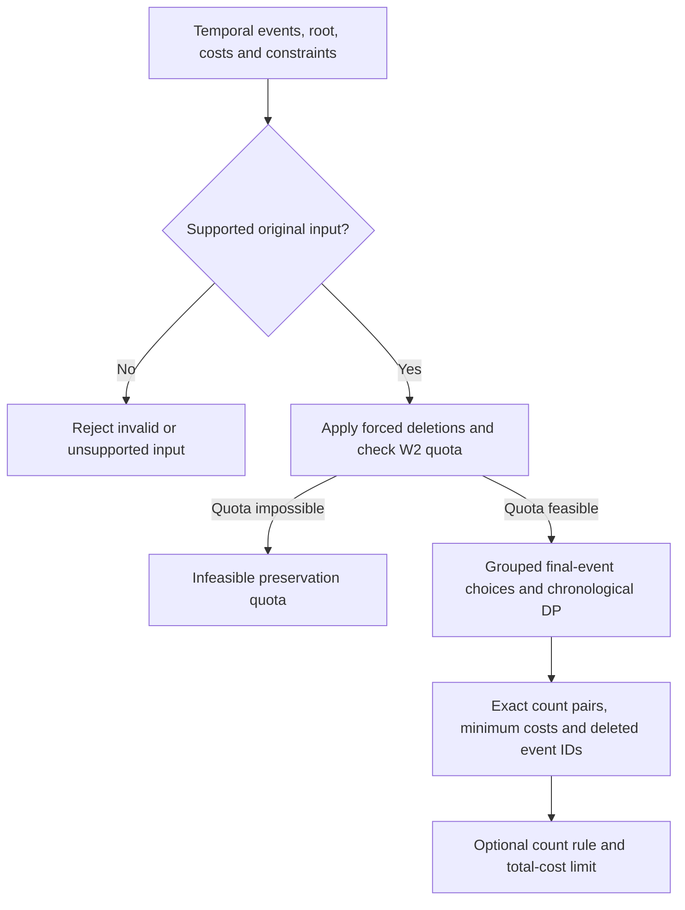
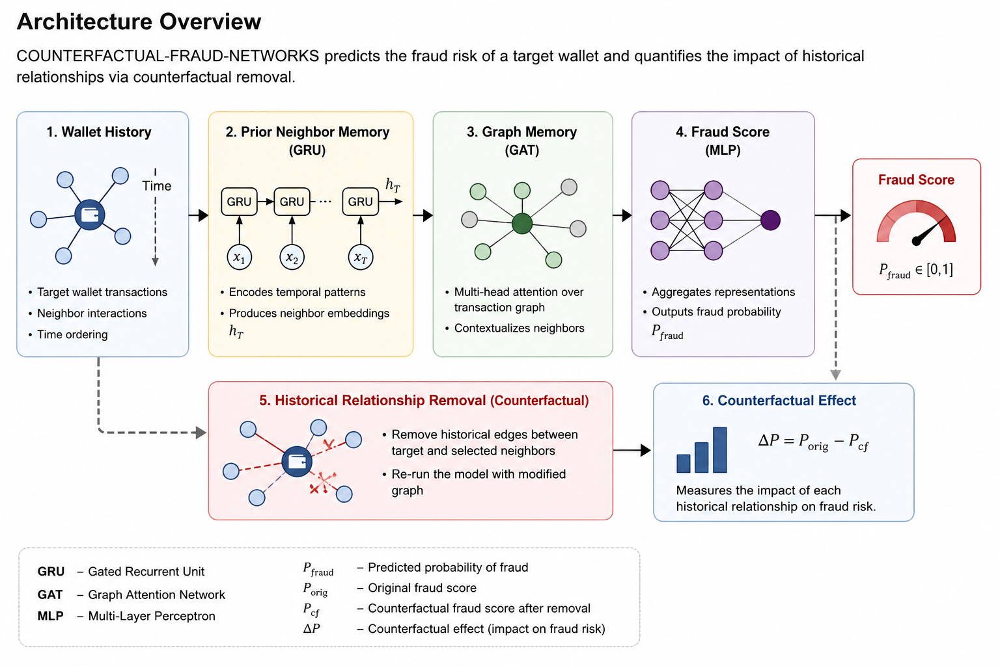
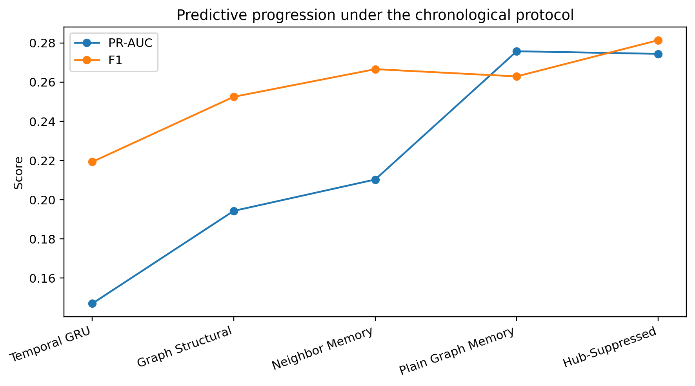
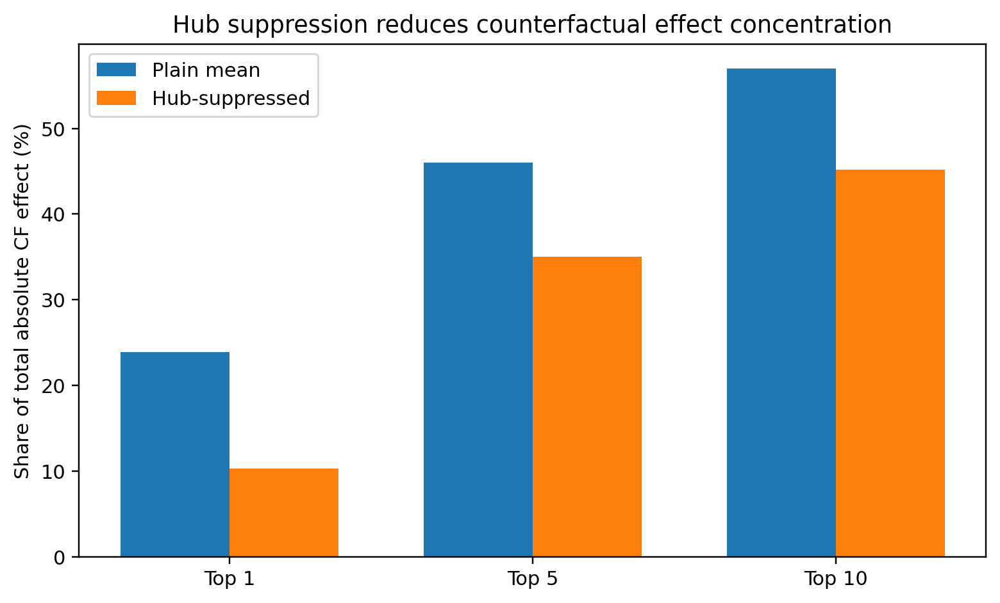

# Temporal Walk Profiles and Transaction Network Research

**Author: Goutam Dyapa**

This repository contains two research studies. The current temporal-profile study
has its own manuscript, solver, synthetic transaction experiments, and reproduction
instructions in `temporal-profiles/`. The earlier Elliptic++ fraud-prediction study
is retained in the original top-level directories.

| Study | Main task | Data and artifacts |
|---|---|---|
| **Current: Minimum-Cost Temporal Walk Profiles** | Exact event-deletion optimization while preserving two-event walks | [Temporal-profile study](temporal-profiles/README.md); synthetic IBM AML transaction histories |
| **Earlier: Historical Counterfactual Fraud Networks** | Fraud prediction and historical relationship sensitivity | Elliptic++ models, experiments, results, and figures; see the earlier-study section below |

## Current study: Minimum-Cost Temporal Walk Profiles

**Minimum-Cost Temporal Walk Profiles on Depth-Three In-Arborescences**  
**Manuscript snapshot:** Working manuscript dated 5 November 2026

- [Read the named manuscript](temporal-profiles/manuscript/Goutam_Dyapa_Temporal_Walk_Profiles.pdf)
- [Study README and solver examples](temporal-profiles/README.md)
- [Mac reproduction instructions](temporal-profiles/docs/REPRODUCIBILITY.md)
- [Results and limitations](temporal-profiles/docs/RESULTS.md)
- [Dataset and frozen cohort](temporal-profiles/docs/DATA.md)
- [Study-specific citation](temporal-profiles/CITATION.cff)

### Architecture overview: exact temporal-profile solver



The input is an explicit event history whose **original** static graph is a directed
tree toward a designated root, with depth at most three. The solver validates that
graph before applying mandatory deletions. `W2` and `W3` count strictly
time-increasing two-event and three-event walks **ending at the root**. Parallel
events retain distinct original identities.

The algorithm respects mandatory keep/delete choices and the lower quota on `W2`.
It groups equivalent final-event choices, runs chronological dynamic programs, and
combines completed tables by exact min-plus convolution. For **every attainable
exact `(W2, W3)` pair satisfying the quota**, it returns a minimum total deletion
cost and an attaining set of original event IDs. An optional final lookup chooses
a minimum-cost profile meeting an exact target, an upper bound, or another allowed
count-based rule, subject to a total-cost limit.

This is an exact combinatorial optimization workflow. Its outputs are count pairs,
costs, and deletion witnesses. It does not train or automatically reevaluate the
earlier wallet-memory fraud model. Applying a full classifier that uses other
deletion-sensitive features requires additional evaluation beyond these profiles.

The IBM batch adapter first extracts a complete incoming-three-hop context for
each query's 24-hour lookback; the diagram starts with the resulting event-list
instance. Unsupported contexts and run limits remain visible in the study's
coverage report.

### Current study results

The completed native Mac batch contains 1,024 fixed synthetic-data queries:

| Outcome | Queries |
|---|---:|
| Empty context | 179 |
| Unsupported structure | 280 |
| Supported context above the event cap | 43 |
| Fully profiled context | 522 |
| **Total** | **1,024** |

Among 232 queries with a positive initial `W3`, 68 received complete profiles.
For initial three-event count `B3`, the target was `U = floor(3 * B3 / 4)`.
At full `W2` preservation, all 68 attained `W3 <= U` within three unit-cost
deletions; 13 attained `W3 = U` within the same cost limit, while the exact target
was unattainable at any cost for the other 55. The
[results guide](temporal-profiles/docs/RESULTS.md) gives the
verification denominators, repeated-policy interpretation, and resource limits.
These are synthetic-data count-optimization results; they do not measure a gain
in fraud-detection accuracy or real-world laundering prevention.

### Run the current study on a Mac

From the repository root, using Python 3.8 or newer and the standard library:

```bash
cd temporal-profiles
python3 implementation/demo.py
python3 analysis/summarize_batch.py results/BATCH_RESULTS.zip
python3 verify_artifacts.py
```

The small examples, saved-result analysis, and integrity check need no IBM dataset
download. Full dataset reproduction is described in the
[Mac guide](temporal-profiles/docs/REPRODUCIBILITY.md). The solver does not require
the neural-network dependencies used by the earlier study below.

### Current research status

The included theory manuscript is a working paper. The completed finite checks and
synthetic-data experiments support the reported implementation evidence; further
independent proof assessment and prior-art comparison remain open. See the
[study README](temporal-profiles/README.md) for the pending generalized deletion
propagation comparison and the manuscript's assistance disclosure.

## Earlier study: Historical Counterfactual Fraud Networks

The architecture image, predictive metrics, counterfactual relationship results,
and installation instructions in this section belong to the earlier Elliptic++
study. They are separate from the exact temporal-profile algorithm above.

<details>
<summary>Open the earlier study's architecture, results, and setup</summary>

**Graph-Aware Temporal Memory with Hub-Robust Relationship Explanations**

This earlier study uses temporal and graph-aware models for cryptocurrency fraud prediction and historical relationship-sensitivity analysis.

### Architecture of the earlier prediction model



The pipeline combines wallet history, strictly prior neighbor information, graph-aware temporal memory, and fraud prediction. Historical relationship interventions then replay the target sequence without a selected relationship to measure its signed counterfactual effect.

### Paper

**Historical Counterfactual Fraud Networks: Graph-Aware Temporal Memory with Hub-Robust Relationship Explanations**

**Author:** Goutam Dyapa  
**Materials:** [Archived manuscript](paper/submitted_manuscript.pdf) and recorded experimental results

### Overview

Fraud in transaction networks is both temporal and relational. A wallet's predicted risk may depend not only on its own behavior, but also on its historical relationships with other wallets.

This project combines:

- Temporal wallet memory
- Graph-aware relational memory
- Strictly prior neighbor information
- Hub-robust aggregation
- Historical counterfactual relationship explanations

The main counterfactual question is:

> Would a wallet still receive the same fraud-risk prediction if a particular historical relationship had not contributed to its graph context?

The counterfactual effects reported by this project describe **model sensitivity**. They should not be interpreted as evidence that a relationship caused illicit behavior.

### Predictive results for the earlier study

| Model | PR-AUC | ROC-AUC | F1 |
|---|---:|---:|---:|
| Temporal-Neighbor Event MLP | 0.2089 ± 0.0099 | 0.7942 ± 0.0136 | 0.2450 ± 0.0137 |
| Plain Graph Memory | **0.2757 ± 0.0022** | **0.8113 ± 0.0130** | 0.2629 ± 0.0179 |
| Hub-Suppressed Graph Memory | 0.2744 ± 0.0096 | 0.8040 ± 0.0123 | **0.2814 ± 0.0155** |

Evaluation uses five random seeds:

`13, 21, 42, 77, 101`

with the chronological split:

- Training: time steps 1–34
- Validation: time steps 35–41
- Test: time steps 42–49

### Figures

#### Predictive Progression



#### Counterfactual Effect Concentration



### Historical Counterfactual Analysis

The counterfactual experiment contains:

- 328 target wallets
- 164 illicit targets
- 164 licit targets
- 578 historical relationship interventions

Hub suppression reduced the single most influential neighbor's share of total absolute counterfactual effect from **23.9% to 10.3%**.

### Earlier study file layout

```text
src/             Reusable model and evaluation utilities
experiments/     Experiment scripts
results/         Predictive and counterfactual results
artifacts/       Model checkpoints and prediction artifacts
data/            Dataset instructions and file manifests
docs/            Reproducibility documentation
paper/           Earlier manuscript and figures
tests/           Repository tests
```

### Dataset

This project uses the **Elliptic++** dataset.

The large raw dataset files are not redistributed in this repository.

Information about the exact dataset files used in the experiments is available in:

```text
data/README.md
data/raw_manifest.json
data/raw_manifest.sha256
```

### Installation

Clone the repository:

```bash
git clone git@github.com:gouthamdyapa/counterfactual-fraud-networks.git
cd counterfactual-fraud-networks
```

Create a Python environment:

```bash
python3.12 -m venv .venv
source .venv/bin/activate
```

Install dependencies:

```bash
python -m pip install --upgrade pip
python -m pip install -e ".[dev]"
```

Run the tests:

```bash
python -m pytest -q
```

### Reproducibility

Detailed reproduction instructions are available in:

```text
docs/REPRODUCIBILITY.md
```

The machine-readable experimental results are stored in:

```text
results/main/
results/counterfactual/
```

### Citation

The root [CITATION.cff](CITATION.cff) describes this earlier study. Use the separate citation file under `temporal-profiles/` for the current study.

</details>

## Citation and license

Use [temporal-profiles/CITATION.cff](temporal-profiles/CITATION.cff) for the current
temporal-profile study and the root [CITATION.cff](CITATION.cff) for the earlier
counterfactual fraud-network study. The repository's existing code license is
[Apache License 2.0](LICENSE). Dataset terms are provided by the respective sources.
