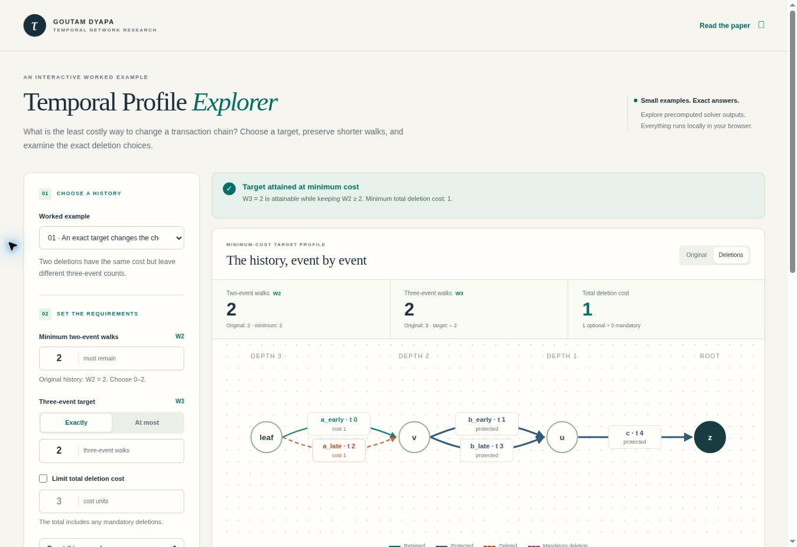

# Temporal Profile Explorer

An offline visual companion to **Minimum-Cost Temporal Walk Profiles on Depth-Three
In-Arborescences**, by **Goutam Dyapa**.

The explorer displays complete, precomputed minimum-cost profile tables for five
small examples already included in this repository. Choose a preservation quota,
an exact or upper-bound target, and an optional total-cost limit. The graph and
event table show the original event IDs in the selected deletion witness.



## Open on a Mac

From the repository root:

```bash
open temporal-profiles/explorer/index.html
```

You can also open `index.html` directly from Finder, or run:

```bash
bash temporal-profiles/explorer/open_mac.command
```

Keep `index.html`, `styles.css`, `data.js`, and `app.js` together. The viewer needs
no Python installation, server, internet connection, or IBM dataset. Paper and
repository links open external pages only when selected.

Alternatively, download the single [Temporal_Profile_Explorer.html](Temporal_Profile_Explorer.html)
file using GitHub's **Download raw file** button and open it from Finder. It embeds
the same interface and data, so it needs no accompanying files.

For a single portable HTML file, use Python 3.8 or newer:

```bash
python3 temporal-profiles/explorer/build_standalone.py --output Temporal_Profile_Explorer.html
open Temporal_Profile_Explorer.html
```

## Try these examples

| Example | What to try | Expected behavior |
|---|---|---|
| An exact target changes the choice | Keep W2 at least 2; switch between exact W3 = 2 and upper bound W3 <= 2 | Different equal-cost deletions can satisfy the two rules. |
| The cheaper deletion wins | Exact W3 = 1, W2 at least 1 | The cost-1 event is selected instead of its cost-100 alternative. |
| An exact count can be missing | W2 at least 2; exact W3 = 3, then upper bound W3 <= 3 | Exact 3 is unattainable; the upper bound costs 1. A total-cost limit of 0 excludes that feasible result. |
| Mandatory deletions change the baseline | Exact W3 = 0; change total-cost limit from 6 to 7, then preservation from 0 to 1 | Mandatory cost 7 is included. Preserving W2 >= 1 is infeasible after the required deletion. |
| A larger worked example | Keep W2 at least 5 and request exact W3 = 1 | Deleting A2 costs 1 and leaves W2 = 10, W3 = 1. The quota allows retaining more than five walks. |

`W2` and `W3` count two-event and three-event walks that end at the designated
root. Event times must increase strictly. Parallel events retain distinct IDs,
even when their endpoints and timestamps coincide. Costs are abstract weights,
not amounts of money or numbers of deleted events.

The status panel distinguishes an infeasible preservation quota, a target that is
unattainable under that quota at any cost, and an attainable target whose minimum
cost exceeds the budget. Inspecting a table row displays that witness separately
from the recommendation for the current target. The table contains one minimum-cost
witness per exact count pair, not every deletion set or every spending level.

The viewer uses precomputed solver outputs. It does not run the dynamic program in
the browser, accept arbitrary transaction files, or evaluate a fraud classifier.
The [reference solver](../implementation/profile_solver.py) remains available for
other supported instances. See the [study README](../README.md) for its scope.

## Evidence and reproducibility

The source fixtures are the four JSON examples in `implementation/examples/` and
the separate frozen `illustration/instance.json`. `data.js` records their SHA-256
digests and the reference solver's digest.

The builder enumerates **78 legal deletion subsets across five fixtures**, compares
the complete minimum-cost tables for **23 quotas**, and replays **258 profile
witnesses across those quota tables**. These are small-example checks, distinct
from the completed IBM transaction experiment. One quota is infeasible after its
mandatory deletion. No original scientific artifact is rewritten by verification.

From the repository root, verify the original research snapshot and this companion:

```bash
python3 temporal-profiles/verify_artifacts.py
python3 temporal-profiles/explorer/verify_data.py
node temporal-profiles/explorer/test_selection.js
python3 temporal-profiles/explorer/build_standalone.py --check
```

The original `MANIFEST.sha256` continues to describe the frozen research snapshot.
Explorer source code is versioned separately in Git; `verify_data.py` checks its
packaged output against the frozen solver and fixtures. Node.js is needed only for
the selection checks, not to use the viewer.

To intentionally regenerate the viewer data after reviewing a source change:

```bash
python3 temporal-profiles/explorer/generate_data.py
python3 temporal-profiles/explorer/verify_data.py
```

The exhaustive counter enumerates explicit event pairs and triples independently
of the solver's counting and dynamic-programming helpers. It checks strict times,
root endpoints, keep/delete constraints, costs, and every attainable exact pair.
This computational separation does not imply an external human review.

## Files

| File | Purpose |
|---|---|
| `index.html`, `styles.css`, `app.js` | Offline interface, diagram, and profile selection |
| `data.js` | Deterministic, verified fixture tables |
| `generate_data.py`, `verify_data.py` | Dataset generation and read-only exhaustive verification |
| `test_selection.js` | Focused checks of target, quota, and budget behavior |
| `build_standalone.py` | Embed the interface and data into one portable HTML file |
| `Temporal_Profile_Explorer.html` | Ready-to-open portable build of the same viewer |
| `preview.jpg` | Screenshot of the verified desktop interface |
| `open_mac.command` | Open the viewer with the Mac's default browser |

Use the [study citation](../CITATION.cff) when citing the temporal-profile work.
This companion follows the repository's [Apache 2.0 code license](../../LICENSE).
